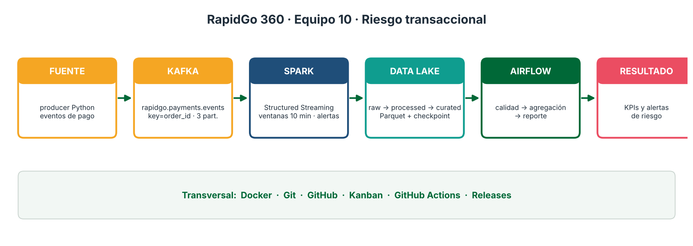
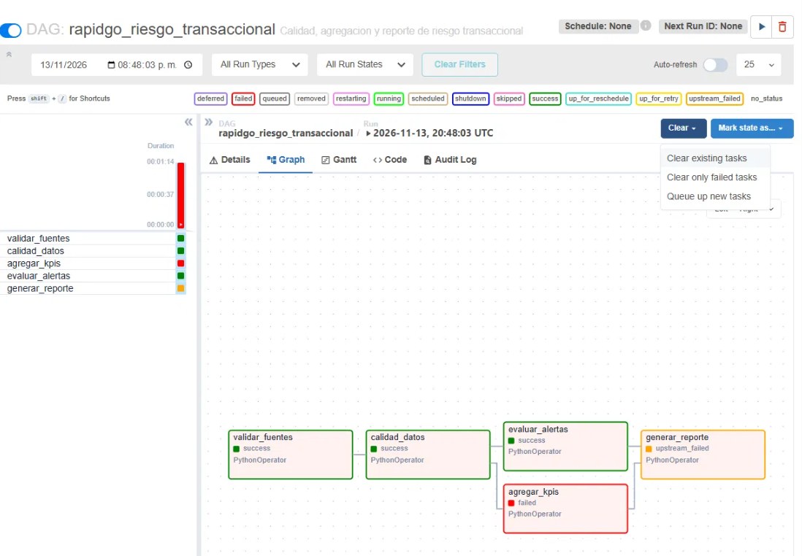
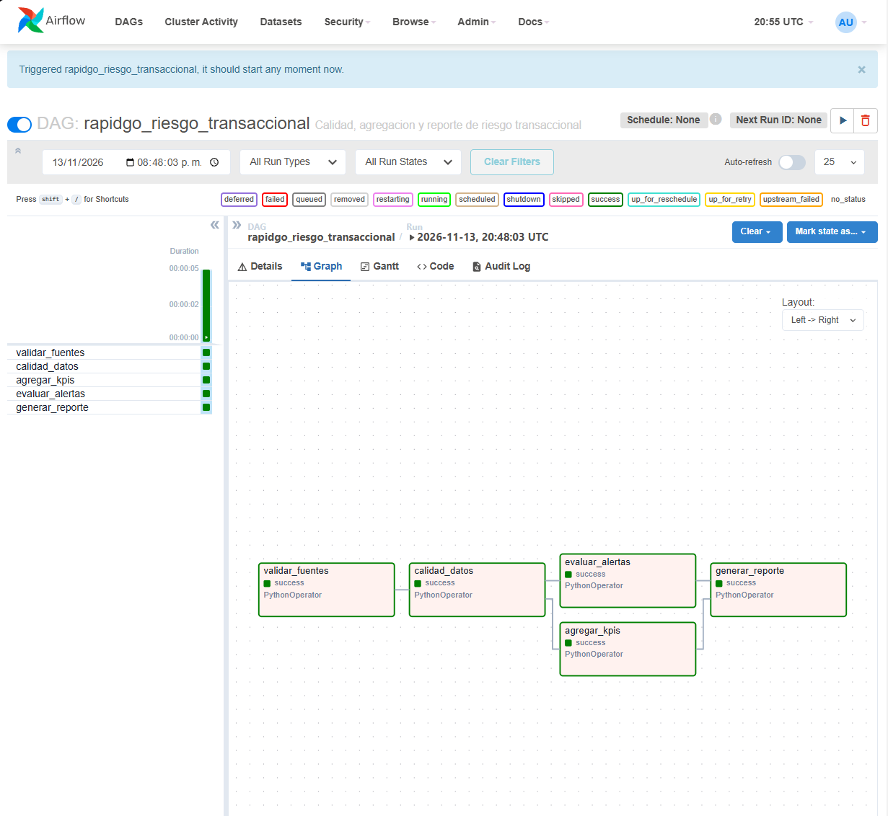

# RapidGo 360 · Equipo 10 · Variante 4: Riesgo transaccional

Proyecto final de la Línea de Profundización I - Big Data
Universidad de Cundinamarca · Ingeniería de Sistemas y Computación (Facatativá)
Docente: Ing. Oscar Jobany Gomez Ochoa

> Estado: **v1.0.0** (Semana 4: integración, quality gate y release final)

## Equipo

|Integrante|Usuario GitHub|Rol principal|
|-|-|-|
|Daniela Vaca|DanielaVaca12|CI y quality gate, estabilización del pipeline|
|Julian Jimenez|Felipe43891|Airflow, cierre del Kanban y release|
|Carlos Barake|Barake00|KPIs y reglas de alerta, ADR-001, README final|

## Problema de negocio

RapidGo es una plataforma de entregas. Durante los pagos y pedidos aparecen comportamientos atípicos: múltiples intentos de pago sobre un mismo pedido, montos inusuales, dispositivos o ubicaciones que no corresponden al usuario. Sin una plataforma de datos que los detecte en tiempo casi real, estos eventos se descubren tarde y generan pérdidas por fraude y mala experiencia.

**Valor de la solución:** un pipeline Big Data que captura los eventos de pago, calcula indicadores de riesgo y dispara alertas cuando se cumplen reglas de negocio, dejando los resultados persistidos en un Data Lake y orquestados con Airflow.

## Arquitectura

```
Generador de eventos (producer, Python)
        |
        v
KAFKA  topic: rapidgo.payments.events  (key = order_id, 3 particiones)
        |
        v
SPARK STRUCTURED STREAMING  (parseo, transformaciones, ventanas, alertas)
        |
        v
DATA LAKE  raw -> processed -> curated   (Parquet + checkpoint)
        |
        v
AIRFLOW  (validar fuentes -> calidad -> KPIs -> alertas -> reporte)
        |
        v
INDICADORES Y ALERTAS DE RIESGO
```



Fuente editable del diagrama en [`docs/arquitectura.md`](docs/arquitectura.md).
Transversal: Docker + Git + GitHub + Kanban + GitHub Actions + Releases.

## Tecnologías y rol

|Tecnología|Rol|
|-|-|
|Python|Producer de eventos, pruebas y reglas|
|Apache Kafka 3.7 (KRaft)|Transporte de eventos de pago|
|Spark 3.5 Structured Streaming|Procesamiento en streaming, ventanas y alertas|
|Data Lake (Parquet)|Persistencia en capas raw / processed / curated|
|Apache Airflow 2.9|Orquestación, calidad y reportes|
|Docker Compose|Ejecución local de la arquitectura|
|GitHub (Issues, Projects, Actions, Releases)|Trazabilidad, CI y entregas|

## Topics, eventos, KPIs y reglas

* **Topic:** `rapidgo.payments.events` · **key:** `order_id` · **particiones:** 3 · **replication factor:** 1 (solo local). Justificación en [ADR-001](docs/decisions/ADR-001-key-particiones-kafka.md).
* **Evento:** contrato en [`docs/contrato-evento.md`](docs/contrato-evento.md) y ejemplos en [`samples/`](samples/) (`payment_event.json`, `payment_event_normal.json`, `payment_event_risky.json`). Campos: `event_id`, `order_id`, `user_id`, `timestamp`, `amount`, `currency`, `payment_method`, `device_id`, `location`, `attempt_number`, `payment_status`.
* **KPIs:** intentos por pedido · valor promedio · eventos de riesgo.
* **Reglas de alerta** (umbrales en [`spark/rules.py`](spark/rules.py), documentadas en [`docs/reglas-kpis-alertas.md`](docs/reglas-kpis-alertas.md)):

|Regla|Condición|Umbral inicial|
|-|-|-|
|A1, múltiples intentos|Un pedido acumula intentos de pago dentro de la ventana|3 o más intentos|
|A2, señales combinadas|Un usuario presenta varias señales anómalas en la ventana|2 o más señales de 3|

Señales de A2: monto mayor a 500.000 COP, más de un dispositivo y más de una ciudad. Un evento se marca como de riesgo cuando supera el monto o alcanza el umbral de intentos.

## Prerrequisitos

* Docker Desktop en ejecución.
* Python 3.12 o superior (probado con 3.12.10) y `pip`.
* Git. En Windows usamos Git Bash; los comandos de abajo están escritos para ese terminal.

```bash
git clone https://github.com/felipe43891/rapidgo-equipo10-riesgo-transaccional.git
cd rapidgo-equipo10-riesgo-transaccional
pip install -r requirements.txt
```

## Cómo ejecutar el pipeline (en tres partes)

El pipeline se levanta en tres partes: Kafka y Spark con `docker-compose.yml`, el producer desde tu computador y Airflow con `docker-compose.airflow.yml`. Spark corre bajo el profile `spark`, así que no arranca con un `up` simple.

**1. Kafka y creación del topic.** El topic debe existir antes de iniciar Spark; si no, Spark falla con `UnknownTopicOrPartitionException`.

```bash
docker compose up -d kafka
MSYS_NO_PATHCONV=1 docker exec rapidgo-kafka /opt/kafka/bin/kafka-topics.sh --create --if-not-exists --topic rapidgo.payments.events --partitions 3 --bootstrap-server localhost:9092
```

**2. Spark Structured Streaming.** La primera vez descarga el paquete de Kafka y tarda 2 o 3 minutos. Espera a que el log muestre `Estado micro-batch`.

```bash
docker compose --profile spark up -d spark-streaming
docker compose logs --tail 15 spark-streaming
```

**3. Producer.** Corre en tu computador y se conecta a `localhost:9092`. Con `--semilla 42` el resultado es reproducible.

```bash
PYTHONIOENCODING=utf-8 python producer/producer.py --pedidos 50 --pausa 0.1 --semilla 42
```

**4. Cerrar las ventanas.** Las capas `curated` se escriben en modo `append` con ventana y watermark de 1 minuto, así que una ventana solo se escribe cuando llegan eventos posteriores. Espera 2 minutos y envía un lote pequeño:

```bash
PYTHONIOENCODING=utf-8 python producer/producer.py --pedidos 5 --pausa 0.1 --semilla 7
```

Comprueba el Data Lake:

```bash
find datalake -name "*.parquet" | head -20
```

**5. Airflow.** El DAG lee y escribe en `datalake/`, que Spark creó como `root`. Antes de ejecutarlo hay que dar permisos de escritura (ver el apartado de fallo y recuperación):

```bash
docker compose -f docker-compose.airflow.yml up -d
MSYS_NO_PATHCONV=1 docker exec -u root rapidgo-airflow chmod -R a+rwX /opt/airflow/datalake
```

**6. Apagar todo.**

```bash
docker compose -f docker-compose.airflow.yml down
docker compose --profile spark down
```

Si vuelves a ejecutar el pipeline desde cero, borra antes los datos generados (no toca archivos versionados):

```bash
git clean -fdx datalake
```

## Cómo acceder a Airflow y ejecutar el DAG

1. Con Airflow levantado, espera 2 o 3 minutos (instala `pandas` y `pyarrow` al arrancar) y abre `http://localhost:8080`.
2. Usuario: `admin`. La contraseña se genera al iniciar el contenedor y cambia cada vez que se recrea:

```bash
docker compose -f docker-compose.airflow.yml logs airflow | grep "password:"
```

3. Busca el DAG `rapidgo_riesgo_transaccional` y pulsa **Trigger DAG**.
4. En la vista **Graph** las cinco tareas deben quedar en verde:

`validar_fuentes` → `calidad_datos` → (`agregar_kpis`, `evaluar_alertas`) → `generar_reporte`

El DAG usa retries y XCom: `validar_fuentes` pasa el número de filas a `calidad_datos`, y `generar_reporte` consolida los resultados de las demás tareas. El reporte final se guarda en `datalake/curated/reportes/` (`.md`, `.json` y `kpis_por_pedido.csv`).

## Cómo ejecutar pruebas y GitHub Actions

Pruebas en local:

```bash
pytest -v
```

Las pruebas cubren el contrato del evento, el producer, las reglas de negocio (`spark/test_reglas.py`) y las tareas del DAG (`tests/test_tareas.py`).

GitHub Actions: el workflow de CI (`.github/workflows/ci.yml`) se ejecuta en cada `push` y `pull_request`, y también de forma manual. Para ejecutarlo a mano: pestaña **Actions** → workflow de CI → **Run workflow** → rama `main`.

## Resultados

Ejecución real del 13 de noviembre de 2026, con dos lotes del producer: el lote principal (50 pedidos, 70 eventos, semilla 42) y un lote de cierre de ventana (5 pedidos, 10 eventos, semilla 7). El reporte generado por el DAG sobre la capa `processed`:

|Medida|Valor|
|-|-|
|Filas en `processed`|80 (10 archivos Parquet)|
|Pedidos|55|
|Intentos por pedido (promedio)|1,455|
|Valor promedio por evento|380.750,74 COP|
|Eventos de riesgo|35 %|
|Alertas A1 (múltiples intentos)|8 pedidos|
|Alertas A2 (señales combinadas)|8 usuarios|
|Duplicados / montos inválidos|0,00 % / 0|

Detalle del lote principal (70 eventos):

* **Particiones:** 29 eventos en la partición 0, 21 en la 1 y 20 en la 2. Todos los intentos de un mismo pedido caen en la misma partición; por ejemplo, los 4 intentos de `ORD-51245` quedaron en la partición 1.
* **Alertas A1:** 6 pedidos con 3 o más intentos: `ORD-18981`, `ORD-88104` y `ORD-51245` (4 intentos), y `ORD-40495`, `ORD-87110` y `ORD-50306` (3 intentos).
* **Alertas A2:** 6 usuarios con las 3 señales: `USR-1023`, `USR-1002`, `USR-1046`, `USR-1027`, `USR-1072` y `USR-1048`.
* **Consumo en Spark:** la suma de los micro-batches (11 + 59 filas) coincide con los 70 eventos enviados.

Evidencias en [`docs/evidencias/`](docs/evidencias/):

* [`producer.txt`](docs/evidencias/producer.txt) y [`producer-cierre.txt`](docs/evidencias/producer-cierre.txt): salida de los dos lotes (partición y offset de cada evento).
* [`topic.txt`](docs/evidencias/topic.txt): descripción del topic (3 particiones).
* [`dag-runs.txt`](docs/evidencias/dag-runs.txt) y [`reporte-log.txt`](docs/evidencias/reporte-log.txt): ejecución del DAG.
* [`reporte-dag.md`](docs/evidencias/reporte-dag.md): reporte final generado por Airflow.
* [`dag-fallo.png`](docs/evidencias/dag-fallo.png) y [`dag-ok.png`](docs/evidencias/dag-ok.png): el DAG con la falla y tras la recuperación.

## Problemas encontrados y cómo se resolvieron

**1. Spark falló con `UnknownTopicOrPartitionException`.** Dos causas a la vez: el checkpoint de una corrida anterior seguía en `datalake/checkpoints/` y recordaba offsets de un topic que ya no existía, y Spark arrancó antes de que el topic existiera (se crea al enviar el primer evento). Se resolvió borrando los datos generados (`git clean -fdx datalake`), creando el topic antes de iniciar Spark y esperando a que Spark estuviera estable antes de lanzar el producer.

**2. Las capas `curated` quedaron vacías.** En modo `append`, una ventana agregada solo se escribe cuando el watermark la supera, y el watermark avanza únicamente cuando llegan eventos nuevos. Al terminar el producer ya no llegaba nada. Se resolvió enviando un lote pequeño de cierre; con él aparecieron 50 filas en `kpis_por_pedido` y 39 en `alertas_por_usuario`.

**3. El DAG falló en `agregar_kpis` y se recuperó.** En el primer run, `agregar_kpis` agotó sus 3 intentos con este mensaje real del log:

```
PermissionError: [Errno 13] Permission denied: '/opt/airflow/datalake/curated/reportes'
```

La tarea `generar_reporte` quedó en `upstream_failed` y las otras tres en verde:



La causa: Spark (que corre como `root`) creó `datalake/curated` y Airflow, que corre como el usuario `airflow` (uid 50000), no podía escribir ahí; las demás tareas solo leen. Se resolvió dando permisos de escritura con `chmod -R a+rwX` y usando **Clear only failed tasks** en Airflow. El mismo run terminó en `success`:



## Decisiones

* [ADR-001: key y particiones de Kafka](docs/decisions/ADR-001-key-particiones-kafka.md)
* [ADR-002](docs/decisions/ADR-002.md)
* [Checkpoint Semana 1](docs/checkpoints/semana1.md) · [Checkpoint Semana 2](docs/checkpoints/semana2.md)

## Estructura del repositorio

```
.github/workflows/   CI
airflow/dags/        DAG rapidgo_riesgo_transaccional y sus tareas
producer/            Generador de eventos
spark/               Job de streaming y reglas de negocio
tests/               Pruebas de reglas, contrato y tareas del DAG
samples/             Eventos de ejemplo
datalake/            Capas raw / processed / curated (no se versionan datos)
docs/                Arquitectura, checkpoints, ADR, contrato y evidencias
docker-compose.yml           Kafka y Spark
docker-compose.airflow.yml   Airflow
```

## Plan por releases

|Release|Semana|Contenido|
|-|-|-|
|v0.1.0-foundation|1|Arquitectura, backlog, contrato, KPIs, ADR-001|
|v0.2.0-streaming|2|Kafka + Spark + Data Lake + tests + CI|
|v0.3.0-orchestration|3|Airflow, fallo controlado y recuperación|
|v1.0.0|4|Quality gate, README final, video, release|

## Tabla de contribuciones

|Integrante|Responsabilidades|Issues / PR principales|
|-|-|-|
|Daniela Vaca|CI y quality gate, estabilización del pipeline|*completar con # de Issues y PR*|
|Julian Jimenez|Compose de Airflow, DAG, cierre del Kanban, release v1.0.0|*completar con # de Issues y PR* (PR #24: DAG de Airflow)|
|Carlos Barake|KPIs y reglas de alerta, ADR-001, README final|*completar con # de Issues y PR*|

## Limitaciones conocidas y trabajo futuro

* Los umbrales de A1 (3 intentos) y A2 (2 señales, monto de 500.000 COP) son iniciales y fijos; falta calibrarlos con datos reales.
* Los datos son sintéticos: el producer genera pedidos normales y anómalos con una proporción configurable.
* Las tablas `curated` dependen de que lleguen eventos nuevos para cerrar ventanas; en producción el flujo es continuo, pero en pruebas hace falta un lote de cierre.
* El permiso de escritura del Data Lake en Airflow se da con un comando manual; falta resolverlo de forma permanente en el compose.
* Kafka con un solo broker y replication factor 1; Airflow en modo `standalone` con SQLite, solo para demostración.
* Trabajo futuro: ejecutar el DAG de forma programada, enviar las alertas a un canal de notificación y desplegar en un entorno con más brokers.

## [Video final](https://youtu.be/y7ZX99DFeYE)

*(https://youtu.be/y7ZX99DFeYE)*
