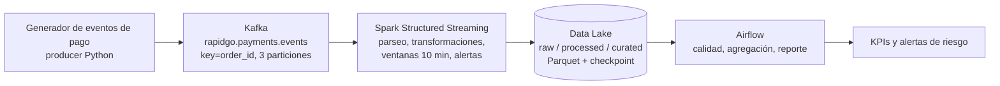

# Arquitectura · Riesgo transaccional (fuente del diagrama)

El archivo `arquitectura.png` se genera a partir de este esquema. Si quieren rehacerlo en draw.io o Excalidraw, usen este mismo flujo.

| Componente | Responsabilidad en la variante |
|---|---|
| Producer | Simula pagos normales y anómalos (reintentos, montos altos, dispositivos y ciudades raros) |
| Kafka | Transporta eventos; la key `order_id` mantiene el orden por pedido |
| Spark | Calcula intentos por pedido, valor promedio, `is_risky` y alertas A1/A2 |
| Data Lake | Persiste cada capa en Parquet con checkpoint |
| Airflow | Valida calidad de raw y curated, agrega y genera el reporte |
