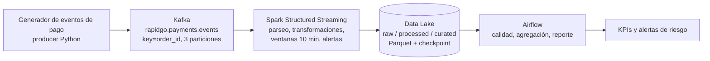

# Arquitectura · Riesgo transaccional (fuente del diagrama)

El archivo `arquitectura.png` se genera a partir de este esquema. Si quieren rehacerlo en draw.io o Excalidraw, usen este mismo flujo.

| Componente | Responsabilidad en la variante |
|---|---|
| Producer | Simula pagos normales y anómalos (reintentos, montos altos, dispositivos y ciudades raros) |
| Kafka | Transporta eventos; la key `order_id` mantiene el orden por pedido |
| Spark | Calcula intentos por pedido, valor promedio, `is_risky` y alertas A1/A2 |
| Data Lake | Persiste cada capa en Parquet con checkpoint |
| Airflow | Valida calidad de raw y curated, agrega y genera el reporte |

## Decisiones de arquitectura propias

- Kafka: lo usamos porque los pagos llegan como eventos continuos y necesitamos un canal que los reciba sin perder ninguno. Al usar order_id como key, todos los eventos de un mismo pedido quedan en la misma partición y conservan su orden. Las 3 particiones permiten procesar varios pedidos en paralelo.

- Spark Structured Streaming: sirve para leer los eventos de Kafka en tiempo real y agruparlos por pedido dentro de ventanas de tiempo. Así podemos contar cuántos intentos de pago tiene cada pedido en pocos minutos y detectar comportamientos raros, como muchos intentos seguidos.

- Data Lake en capas: separamos raw, processed y curated para no perder nunca el dato original. En raw guardamos los eventos tal como llegan, en processed los limpiamos y estandarizamos, y en curated dejamos los datos listos para calcular KPIs. Si algo sale mal en una capa, podemos reprocesar desde la anterior sin volver a pedir los datos.

- Airflow: en nuestra variante orquesta y programa las tareas del pipeline, como mover los datos entre capas, calcular los KPIs y generar las alertas. Controla el orden en que corren, cuándo se ejecutan y qué pasa si una tarea falla.
